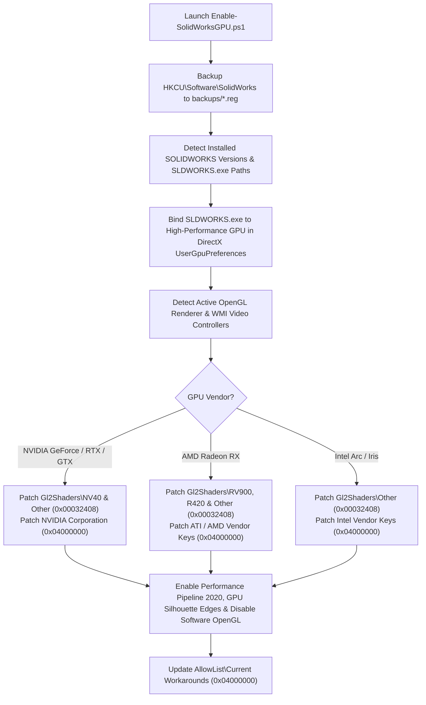

<div align="center">

# ⚡ SOLIDWORKS GPU Hardware Acceleration & RealView Enabler

**Unlock OpenGL Hardware Acceleration, Enhanced Graphics Performance (Pipeline 2020), and RealView Shaders on NVIDIA GeForce (RTX 50/40/30/20 & GTX), AMD Radeon RX, and Intel Arc GPUs.**

[](LICENSE)
[](https://github.com/muradjabir/solidworks-gpu-enabler)
[](https://github.com/muradjabir/solidworks-gpu-enabler)
[](Enable-SolidWorksGPU.ps1)

</div>

---

## 💡 Why This Exists

By default, **SOLIDWORKS** checks a hardcoded registry allowlist (`AllowList` / `Gl2Shaders`) to decide whether your graphics card is allowed to use **OpenGL Hardware Acceleration**, **Enhanced Graphics Performance**, and **RealView Graphics**.

When using consumer GPUs—such as the **NVIDIA GeForce RTX 50-series (RTX 5050 / 5060 / 5070 / 5080 / 5090)**, **RTX 40/30/20-series**, **AMD Radeon RX**, or **Intel Arc**—SOLIDWORKS often treats them as unrecognized hardware, falling back to CPU-bound rendering or locking out RealView hardware shaders.

> [!IMPORTANT]
> **Zero Driver Modding Required:** You do **not** need to modify NVIDIA/AMD `.inf` driver files, disable Windows Driver Signature Enforcement, or flash a Quadro/Workstation vBIOS. This tool safely configures SOLIDWORKS's local `HKEY_CURRENT_USER` hardware tables and Windows DirectX GPU preferences.

---

## ✨ Key Features

| Feature | Description |
| :--- | :--- |
| 🎯 **Auto-Detects Any GPU** | Reads the active OpenGL renderer directly from SOLIDWORKS (`AllowList\Current`) **and** queries Windows WMI (`Win32_VideoController`) so cards are detected even before SOLIDWORKS is opened. |
| 🖥️ **SOLIDWORKS 2015–2026+ Support** | Patches both modern `HKCU\Software\SolidWorks\AllowList` keys (SW 2022–2026+) and legacy `Performance\Graphics\Hardware` keys (SW 2015–2021). |
| 🚀 **Hybrid Laptop GPU Fix** | Automatically binds `SLDWORKS.exe` to **High Performance (`GpuPreference=2;`)** in Windows Graphics Settings so Optimus/Enduro laptops never get stuck on integrated graphics. |
| 🛠️ **Literal & Prefix Key Matching** | Uses the `.NET` Win32 Registry API to register exact renderer strings containing slashes (e.g. `NVIDIA GeForce RTX 5050/PCIe/SSE2`), stripped names (`NVIDIA GeForce RTX 5050`), and family prefixes (`NVIDIA GeForce RTX`). |
| 🎨 **Performance Pipeline Unlocker** | Enables **Enhanced Graphics Performance (`Use Performance Pipeline 2020`)**, **GPU Silhouette Edges**, and **OpenGL Display Shaders**, while disabling forced **Software OpenGL**. |
| 🛡️ **Automatic Backup & 1-Click Restore** | Exports a timestamped `.reg` backup of `HKCU\Software\SolidWorks` into `backups/` before every run, with one-click rollback via GUI or CLI. |

---

## 🚀 Quick Start

### Method 1: One-Line PowerShell Command (No Download Required)
Open **PowerShell** and run:

```powershell
git clone https://github.com/muradjabir/solidworks-gpu-enabler.git; cd solidworks-gpu-enabler; .\Install-SolidWorksGPU.bat
```

### Method 2: Interactive GUI Installer
1. Download or clone this repository:
   ```cmd
   git clone https://github.com/muradjabir/solidworks-gpu-enabler.git
   ```
2. Double-click **[`Install-SolidWorksGPU.bat`](Install-SolidWorksGPU.bat)**.
3. Review your detected SOLIDWORKS version(s) and GPU(s).
4. Click **Enable Hardware Acceleration & RealView**, then restart SOLIDWORKS.

---

## 💻 Command-Line (CLI) Usage

For silent/unattended setup or IT deployment scripts, use [`Enable-SolidWorksGPU.ps1`](Enable-SolidWorksGPU.ps1) directly:

```powershell
# Automatically detect and patch all GPUs and SOLIDWORKS installations
.\Enable-SolidWorksGPU.ps1 -Auto

# Add a specific custom OpenGL Renderer string (e.g. before first launch)
.\Enable-SolidWorksGPU.ps1 -Auto -CustomRenderer "NVIDIA GeForce RTX 5050/PCIe/SSE2"

# Custom shader workaround flags (default: 0x00032408)
.\Enable-SolidWorksGPU.ps1 -Auto -ShaderWorkarounds 0x00030008

# Restore the most recent automatic registry backup
.\Enable-SolidWorksGPU.ps1 -Restore
```

---

## 🔍 How It Works Under the Hood



### Registry Paths Modified

1. **Windows DirectX High-Performance GPU Binding**:
   - `HKCU\Software\Microsoft\DirectX\UserGpuPreferences` → `<Path\To\SLDWORKS.exe> = "GpuPreference=2;"`
2. **SOLIDWORKS Modern AllowList (2022–2026+)**:
   - `HKCU\Software\SolidWorks\AllowList\Current` → `Workarounds = 0x04000000`
   - `HKCU\Software\SolidWorks\AllowList\Gl2Shaders\NV40\<Renderer>` → `Workarounds = 0x00032408`
   - `HKCU\Software\SolidWorks\AllowList\NVIDIA Corporation\<Renderer>` → `Workarounds = 0x04000000`
3. **SOLIDWORKS Legacy Hardware List (2015–2021)**:
   - `HKCU\Software\SolidWorks\SOLIDWORKS 20XX\Performance\Graphics\Hardware\Gl2Shaders\NV40\<Renderer>`
   - `HKCU\Software\SolidWorks\SOLIDWORKS 20XX\Performance\Graphics\Hardware\NVIDIA Corporation\<Renderer>`
4. **SOLIDWORKS Viewport Performance Flags**:
   - `Use Performance Pipeline 2020 = 1`
   - `Use GPU Silhouette Edges = 1`
   - `OGL Display Shaders = 1`
   - `Software OpenGL = 0`

---

## ✅ Verifying Hardware Acceleration in SOLIDWORKS

1. **Restart SOLIDWORKS** if it was running when you applied the patch.
2. With **no files open**, navigate to **Tools** → **Options** → **System Options** → **Performance**:
   - Confirm **Use Software OpenGL** is **unchecked**.
   - Scroll to the bottom and confirm **Enhanced graphics performance (requires SOLIDWORKS restart)** is **checked**.
3. Open any 3D part or assembly and click **View Settings** (monitor icon in the top viewport toolbar) → **RealView Graphics**.

---

## ❓ Troubleshooting

<details>
<summary><b>"Use Software OpenGL" is still greyed out and checked on my laptop</b></summary>

1. Close SOLIDWORKS completely.
2. Open **Windows Settings** → **System** → **Display** → **Graphics**.
3. Verify `SLDWORKS.exe` is set to **High Performance (NVIDIA / AMD Dedicated GPU)**.
4. Re-run `Install-SolidWorksGPU.bat`, click **Enable Hardware Acceleration & RealView**, and launch SOLIDWORKS again.
</details>

<details>
<summary><b>Shadows or reflections look glitchy in RealView</b></summary>

Some GPU architectures prefer alternative shader workaround bitmasks (`0x00030008`, `0x00030408`, or `0x00040000`). Run:
```powershell
.\Enable-SolidWorksGPU.ps1 -Auto -ShaderWorkarounds 0x00030008
```
Also consider switching from **NVIDIA Game Ready Drivers** to **NVIDIA Studio Drivers** for improved OpenGL viewport stability in CAD applications.
</details>

<details>
<summary><b>How do I completely undo all changes?</b></summary>

Open the GUI via `Install-SolidWorksGPU.bat` and click **Restore Backup**, or run:
```powershell
.\Enable-SolidWorksGPU.ps1 -Restore
```
You can also double-click any `.reg` file inside the `backups/` folder.
</details>

---

## 📄 License

Distributed under the **MIT License**. See [`LICENSE`](LICENSE) for full details.
